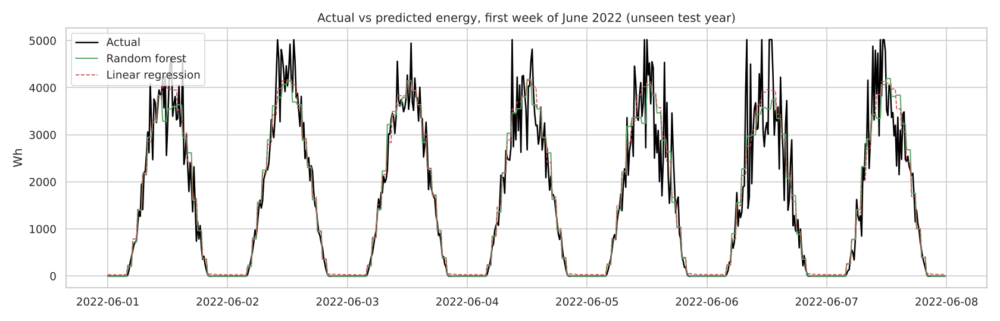
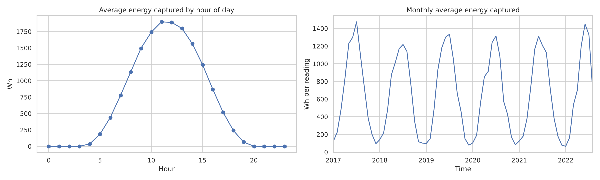

# Solar Energy Output: Weather-Driven Prediction and Forecast Validation

[](https://github.com/mohammedelsayed741996-blip/solar-energy-forecasting/actions/workflows/tests.yml)
[](https://colab.research.google.com/github/mohammedelsayed741996-blip/solar-energy-forecasting/blob/main/notebooks/solar_energy_forecasting.ipynb)
 

How well can the energy captured by a solar plant be predicted from weather data, and how much of that skill survives on a year the model has never seen? This project cleans 197,000 quarter-hourly readings, explores daily and seasonal patterns, compares linear regression with a random forest under **two validation schemes**, and builds a January output scenario from observed weather.

> **Data note.** The dataset is **simulated** (`src/generate_data.py`, fixed seed): a small PV plant in central Europe, 2017 to mid-2022, with an hourly weather station and a 15-minute energy meter. The plant output also reflects things the weather columns cannot see (passing clouds, panel ageing, soiling, snow, outages), and typical data-quality problems are planted on purpose.

## Results

| Validation | Model | R² | MAE (Wh) | RMSE (Wh) |
|---|---|---|---|---|
| Random 80/20 split | Linear regression | 0.858 | 197 | 409 |
| Random 80/20 split | Random forest | 0.860 | 188 | 406 |
| **Chronological: train 2017–2021, test 2022** | Linear regression | 0.870 | 216 | 427 |
| **Chronological: train 2017–2021, test 2022** | Random forest | 0.866 | 212 | 434 |

* **Error grows on the unseen year** (MAE +10–13%). A random split hides this, because neighbouring 15-minute readings share the same hourly weather values.
* **Sunlight intensity drives almost everything.** The random forest barely beats linear regression, because output is close to proportional to irradiance.
* **Panel ageing shows up in the forecast.** For January 2022 (not in training) the model predicts 79.3 Wh per reading against 65.1 Wh observed. A production model needs a time trend or regular retraining.
* **January scenario:** under the weather of past Januaries the model gives 79–133 Wh per reading (central 114 Wh). This is a weather scenario, not a forecast of next year's weather.




## Approach

1. **Data quality.** Each numeric column is parsed explicitly and unparseable text is counted (39 cells). Physically impossible values (cloud cover of −250%, negative energy) are set to missing, then all gaps are filled by time interpolation. Nothing is silently dropped.
2. **Exploration.** Distributions, correlation matrix, average output by hour of day and by month.
3. **Models.** Linear regression vs random forest (100 trees, `min_samples_leaf=5`) on the five weather variables, with predictions clipped at zero.
4. **Validation.** A random 80/20 split for reference, and a chronological split as the real test.
5. **January history and scenario.** Observed January averages per year are computed from the data and compared with model estimates.

## Repository structure

```
├── data/solar_weather.csv.gz                    simulated dataset (see data/README.md)
├── notebooks/solar_energy_forecasting.ipynb     full analysis with outputs
├── reports/figures/                             charts
├── reports/model_results.csv                    model comparison written by the notebook
├── src/generate_data.py                         reproducible data generator
└── tests/                                       pytest checks for the data
```

## Run it

```bash
pip install -r requirements.txt
python src/generate_data.py        # optional: rebuilds data/ (same seed, same file)
pytest -q
jupyter notebook notebooks/solar_energy_forecasting.ipynb
```

Or click **Open in Colab**: the notebook reads the data straight from this repository.

## Tech stack

Python · pandas · NumPy · scikit-learn (LinearRegression, RandomForestRegressor) · matplotlib · seaborn · pytest · GitHub Actions

---
Mohamed Abdelrasoul · [LinkedIn](https://www.linkedin.com/in/mohamed-abdelrasoul-b07002173) · [GitHub](https://github.com/mohammedelsayed741996-blip)
